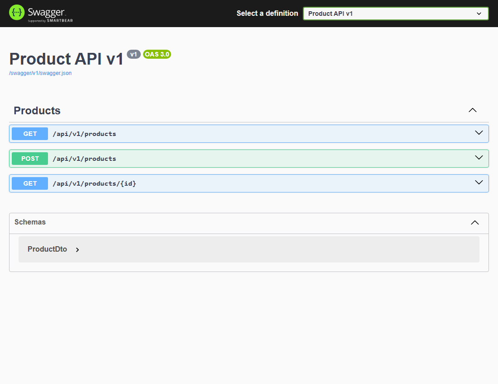

# Домашнее задание 08 — версии API товаров

## Краткий отчёт

Создан каталог товаров с версиями v1 и v2. Данные хранятся в общем списке в памяти.

## Выполнение по заданию

### 1. Версия v1

Получение списка и товара по ID, добавление товара. Ответ содержит `id`, `name`, `price`.

### 2. Версия v2

Получение, добавление, изменение и удаление. Дополнительно возвращаются категория, количество и доступность. Есть фильтрация по категории и цене.

### 3. Проверка данных и версий

Название обязательно, цена должна быть больше нуля, количество не может быть отрицательным. Использованы отдельные контроллеры и DTO, общий сервис и фильтрация LINQ. OpenAPI содержит отдельные документы v1 и v2.

### 4. Проверка запросов

| Действие | Результат |
|---|---|
| GET товара через v1 и v2 | 200, разные форматы ответа |
| POST через v1 и v2 | 201, товар виден в обеих версиях |
| PUT через v2 | 200, изменения видны через v1 и v2 |
| Фильтрация v2 | 200, подходящие товары |
| Несуществующий ID | 404 |
| Отрицательная цена | 400 |
| DELETE через v2 | 204 |
| Неподдерживаемая v3 | 404 |

## Запуск

В PowerShell из этой папки:

```powershell
& "$env:LOCALAPPDATA\Programs\dotnet-sdk\dotnet.exe" run --urls http://localhost:5088
```

Откройте `http://localhost:5088/swagger` и выберите v1 или v2. Нажмите нужный запрос, затем **Try it out** и **Execute**. На другом компьютере с .NET SDK 10 используйте `dotnet run --urls http://localhost:5088`.

## Скриншот выполнения



## Вывод

Изменения в общем каталоге доступны в обеих версиях. Разные DTO сохраняют формат ответа каждой версии.
